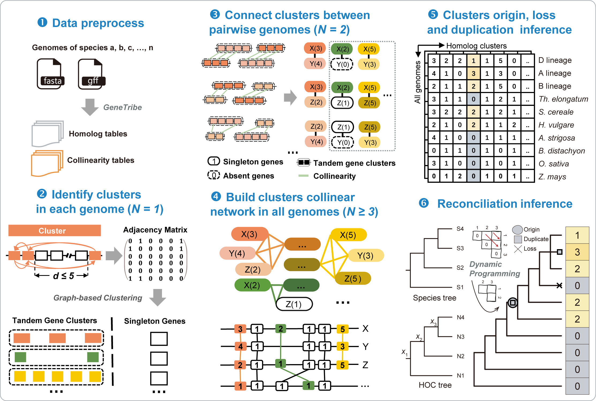

# What is Goldminer

**Goldminer**, which used homologous gene clusters (HOCs) as the basic unit for investigating gene evolution and aligns pan-genomic HOCs hierarchically from cross-species to cross-genera level.



**Figure 1.** The core workflow of Goldminer.

## Command

```sh
goldminer -h
```

```sh
# Program: GoldMiner (A tool for the homology gene cluster 'HOC' - Origin, Loss and Duplication Minmer.)
# Version: 1.0.0
# 
# Usage: goldminer <command> [options]
# 
# Subcommands include:
# 
# [ pipeline ]
#      TDGFinder      Step2: Identify clusters ineach genome (N = 1)
#      PairLink       Step3: Connect clusters betweenpairwise genomes (N = 2)
#      MultiCluster   Step4: Build clusters colinear network in all genomes (N ≥ 3)
#      OdlRecon       Step5&6: Clusters origin, loss and duplication inference
# 
# [ tool ]
#      HocAliPlot     Dotplot of HoC alignment between two genomes
# 
# Author:    Xie,Xiaoming
# Email:     xiexm@cau.edu.cn
# Homepage:  https://github.com/xiexm1/goldminer
```

# Installation

## Requirements

**Goldminer** is implemented in `R` and `python`, and three external command-line tools, which are executable on your `PATH`, are needed:

- R ≥ 4.0
- R packages: `igraph`, `reshape2`, `dplyr`, `parallel`, `data.table`
- Python 3.x
- MCL tool (for clustering analysis)

## Install

Before installing **Goldminer**, the above three tools should be available.

**1. Download.** Download the latest version of **Goldminer** from [GitHub](https://github.com/xiexm1/goldminer). We only provide Linux 64-bit version.

```sh
git clone https://github.com/xiexm1/goldminer.git
```

**2. Install.** Run the script to install **Goldminer**.

```sh
cd goldminer
./install.sh
```

**3. PATH.** Add **Goldminer** to your system PATH if necessary.

```sh
vi ~/.sh_profile
# add the following lines to the end of ~/.sh_profile
export PATH=/path/to/goldminer/:$PATH
source ~/.sh_profile
```

**4. Help.** View help of **Goldminer**.

```sh
goldminer -h
```

# Quick start

## Step 1: Genome Comparison Analysis

This tool relies on **genetribe** for core gene comparison between genomes. genetribe serves as a foundational framework for gene collinearity and orthology analysis.

For more details about genetribe and its functionalities, visit [genetribe Website](https://chenym1.github.io/genetribe/) and [TGT database](http://wheat.cau.edu.cn/TGT/).

```sh
genetribe core -l rice -f rice
genetribe core -l aet -f aet
genetribe core -l aet -f rice
```

## Step 2: Identify Gene Clusters

Use TDGFinder to identify gene clusters in each genome:

```sh
goldminer TDGFinder -f data_path -b genome_bed_path -o output_path -s subgenome_info_file -t num_threads -d max_distance
```

Parameters:

- `-f/--one2many`: one2many file path
- `-b/--bed`: bed file path
- `-o/--output`: output file path
- `-t/--threads`: threads to use in parallel
- `-d/--distance`: the max distance of tandem genes
- `-s/--subgenome`: the file of subgenome

## Step 3: Connect Clusters Between Pairwise Genomes

Use PairLink to connect clusters between pairwise genomes:

```sh
goldminer PairLink -l first_genome_prefix -f second_genome_prefix -o output_path -c cluster_path -i iblocks_path -b blocks_path -t num_threads
```

Parameters:

- `-l/--first`: Prefix name of first file
- `-f/--second`: Prefix name of second file
- `-t/--threads`: threads to use in parallel
- `-o/--out`: link file output path
- `-c/--clu`: cluster file path
- `-i/--iblocks`: iblocks file path
- `-b/--blocks`: blocks file path

## Step 4: Build Clusters Colinear Network

Use MultiCluster to build clusters colinear network in all genomes:

```sh
goldminer MultiCluster -d output_directory -i input_directory -t genome_list_file -p output_prefix -c cluster_files_directory
```

Parameters:

- `-d/--dir`: directory of output files
- `-i/--input`: directory of input files
- `-c/--cluster`: directory of cluster files
- `-t/--table`: genome list file
- `-p/--prefix`: prefix of output file

## Step 5&6: Infer Evolutionary Events

Use OdlRecon to infer cluster origin, loss, and duplication events:

```sh
goldminer OdlRecon data_path file_prefix selected_groups
```

Parameters:

- `path`: Path to the data files
- `prefix`: Prefix for the data files
- `selected_groups`: Comma-separated string of selected groups (e.g., 'D,A,B,Thinopyrum,Secale,Hordeum,Avena,Brachypodium,Oryza,Zea')

## Output Files

- `.cludb` files: Gene cluster database files
- `.clu` files: Gene cluster information files
- `.link` files: Mapping files between genome clusters
- `.matrix` files: Wide-format matrices for gene cluster comparison
