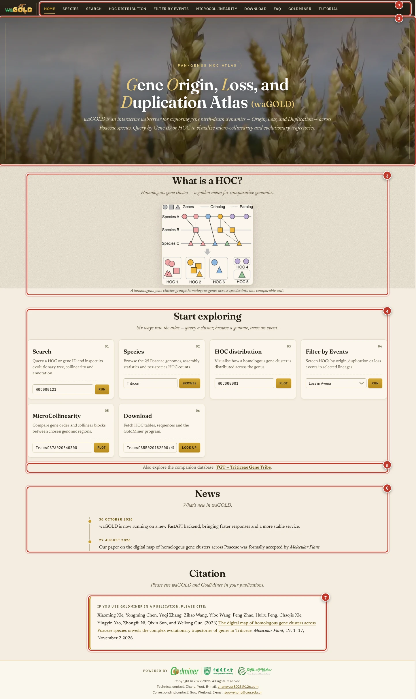
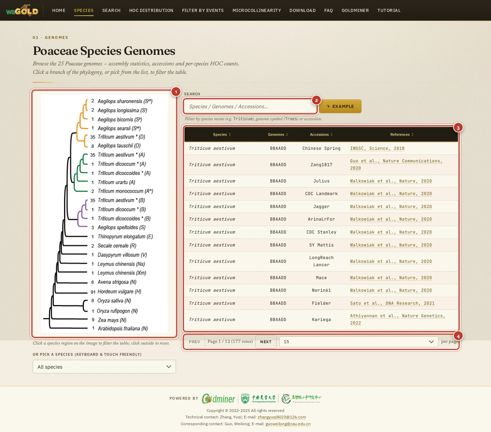
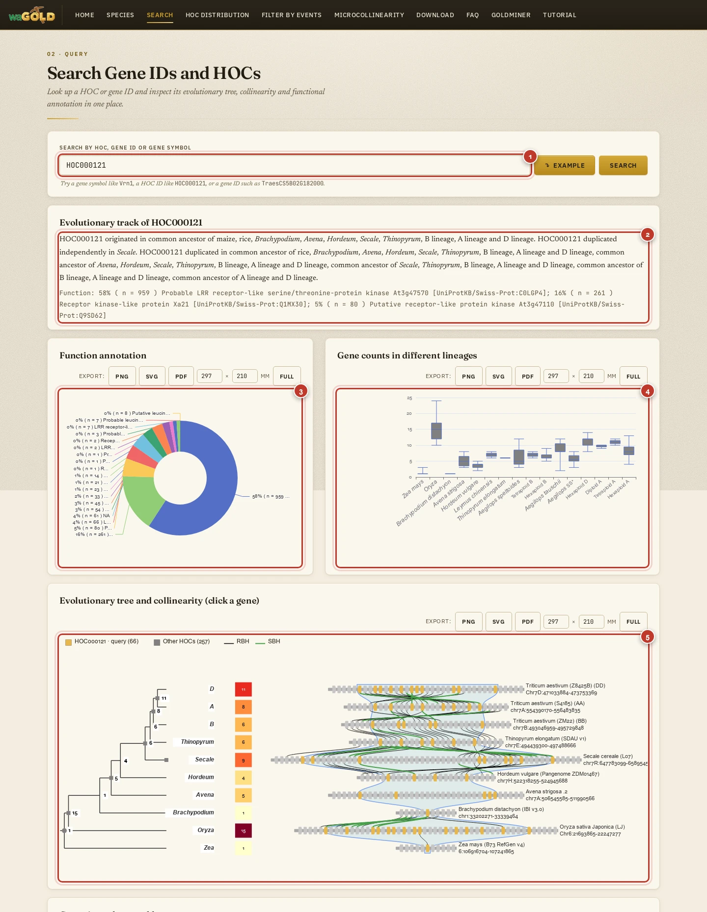
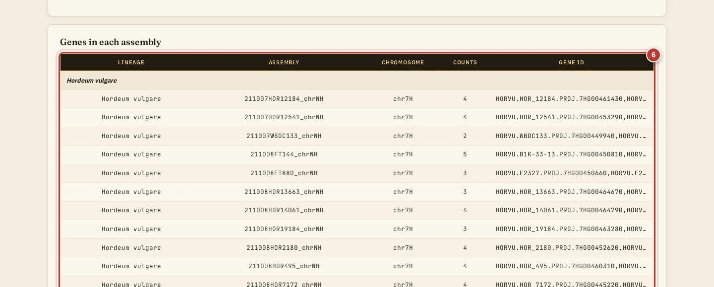
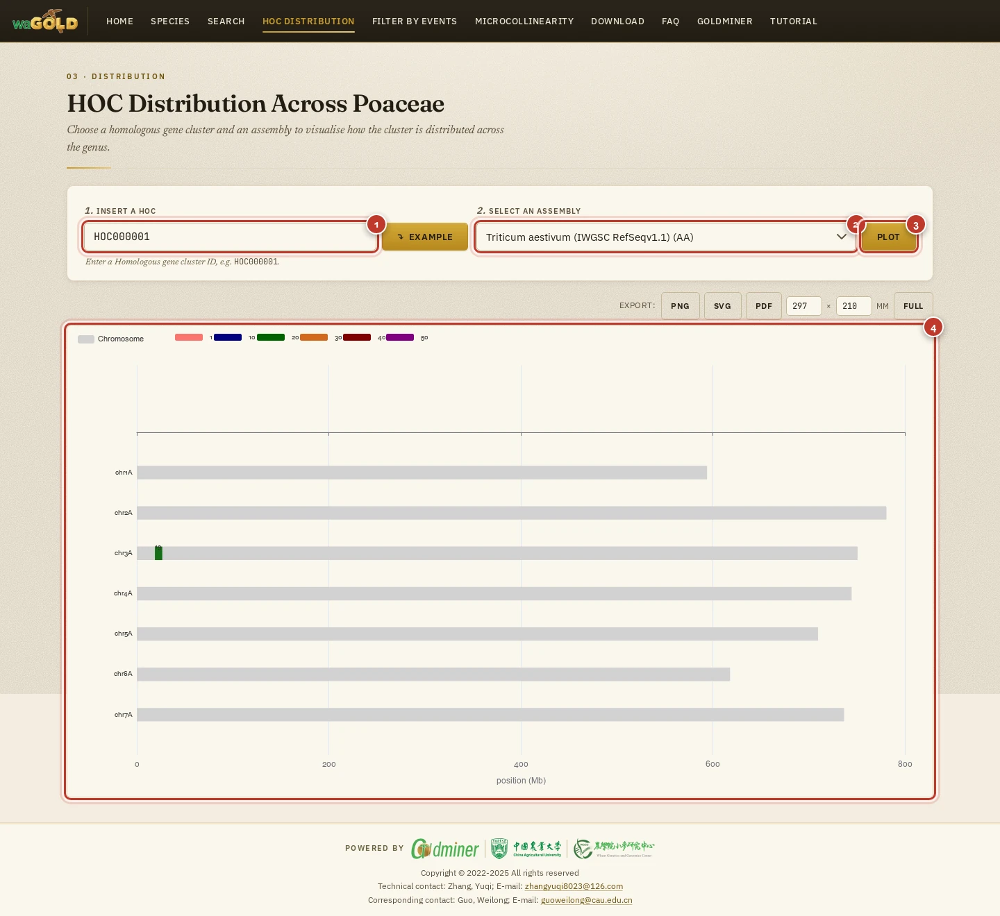
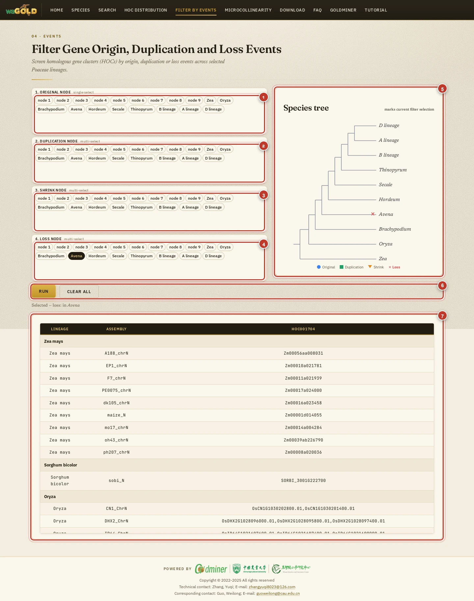
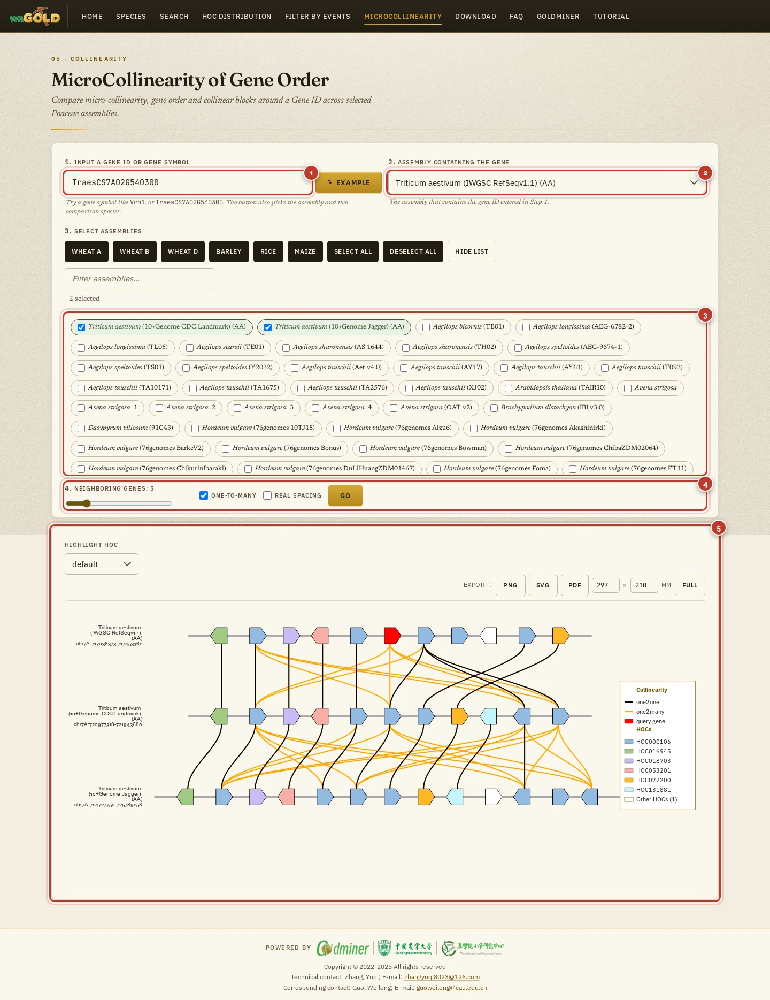
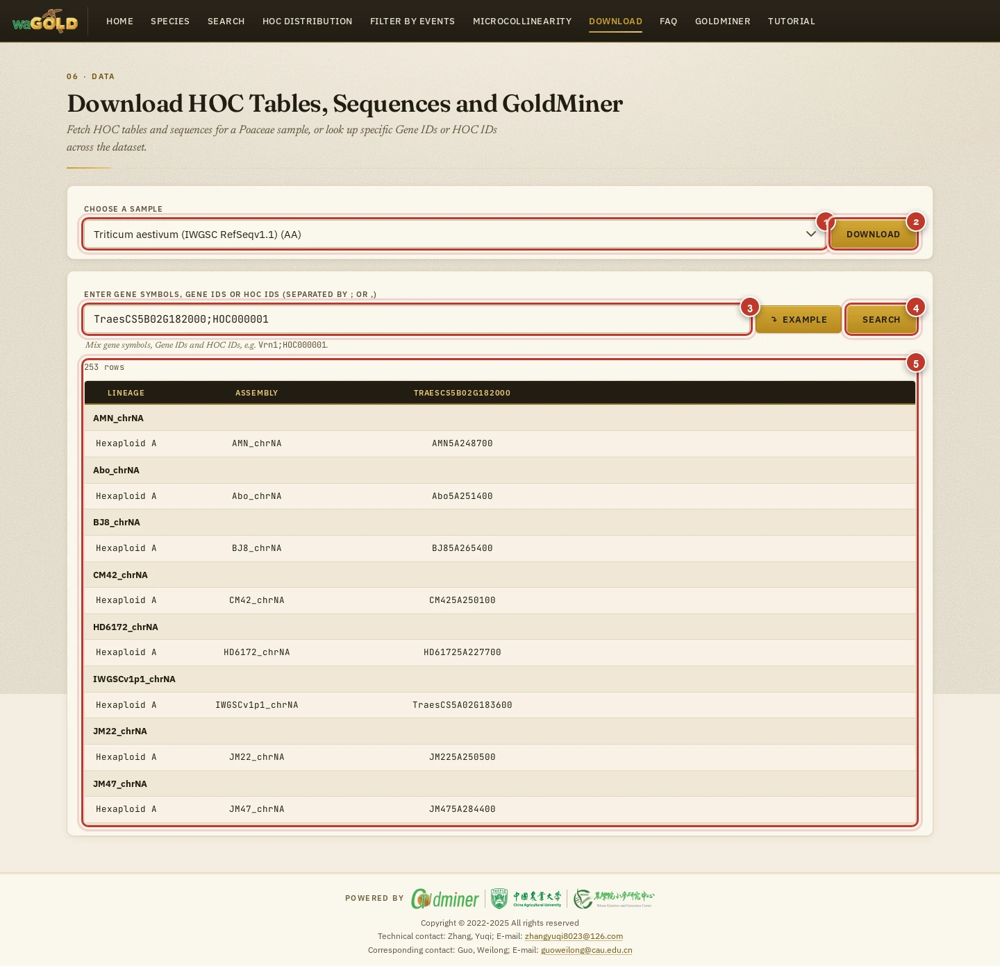
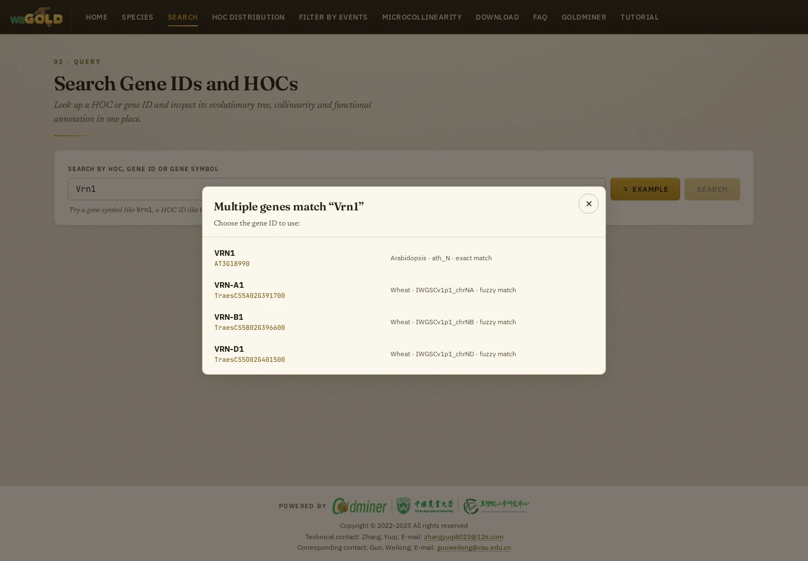
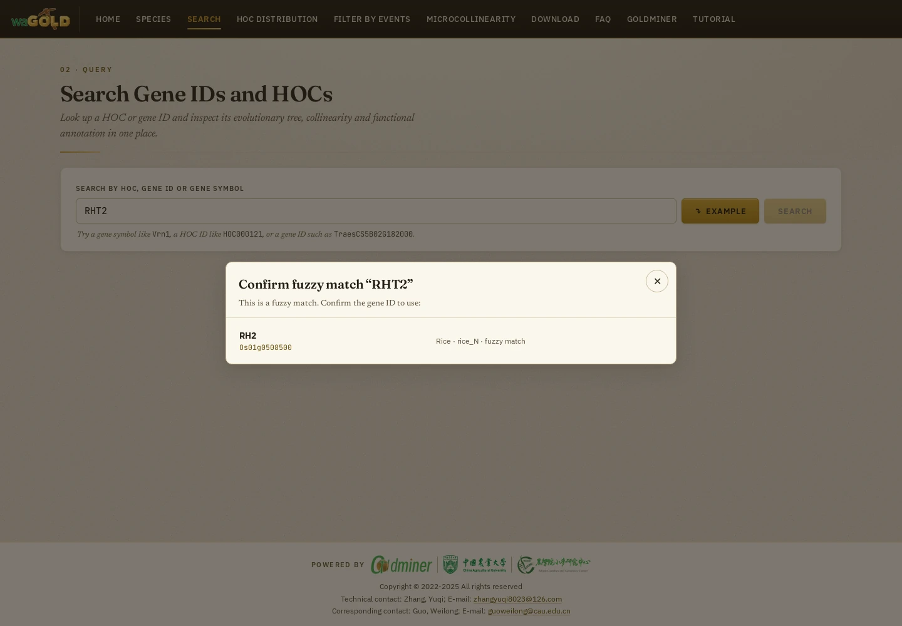

# General

## Quick start: the waGOLD homepage

**1. Top navigation.** Jump directly to Species, Search, HOC distribution, Filter by Events, MicroCollinearity, Download and FAQ.

**2. Homepage hero.** The eyebrow reads **Pan-genus HOC Atlas**. waGOLD is an interactive webserver for exploring gene birth-death dynamics — Gene Origin, Loss and Duplication — across Poaceae species.

**3. What is a HOC?** A short definition and schematic of a Homologous Gene Cluster (HOC).

**4. Start exploring.** Six functional cards, each with a prefilled example (Gene ID, HOC ID or gene symbol). Edit the value if needed and click the action button to open the corresponding page with the example already running.

**5. TGT link.** Opens the companion TGT (Triticeae Gene Tribe) database.

**6. News.** Release notes, including the FastAPI backend update and paper acceptance.

**7. Citation.** If you use GoldMiner or waGOLD in a publication, please cite the paper shown here.

## Note

waGOLD provides interactive visualization, data export (PNG, SVG, PDF and tables), and links to external databases. Form-based tools use numbered steps. Most modules have an input area at the top and an output area below.

Every `Example` button loads a valid default query. Use it to explore the output format before entering your own Gene ID or HOC ID.

# Species

**1. Species phylogeny.** The tree is derived from GoldMiner and shows the relationships among the 25 Poaceae genomes. Click a branch or species label to filter the table.

**2. Search box.** Filter by species name, genome symbol or accession, for example `Triticum` or `Traes`.

**3. Genome table.** Displays species, chromosome-group symbols, assembly statistics, accessions and publication references.

**4. Pagination.** Change the page size or page through the table.

# Search

**1. Search by HOC or Gene ID.** Enter a HOC ID such as `HOC000121`, or a Gene ID such as `TraesCS5B02G182000`, and press `Search`.

**2. Evolutionary track.** A text summary of the inferred origin, duplication and loss events for the HOC, plus a putative function derived from member genes.

**Query alert.** Above the results, a green Info alert (`ⓘ Search resolved`) records what you entered, whether it was an exact match, fuzzy match or user selection, the resolved Gene ID and assembly, the resolved HOC, and the query status. For example, `Query RHT2 was fuzzy matched to Os01g0508500 (RH2) via fuzzy search.` Use it to verify that a symbol such as `Rht2` resolved to the gene you expected.

**3. Function annotation.** Interactive pie chart showing the functional classification and proportions of genes in the HOC.

**4. Gene counts in different lineages.** Box plots showing the distribution of gene counts across lineages.

**5. Evolutionary tree and collinearity.** This combined chart contains:
- **Species tree (left):** terminal numbers are gene counts in each species; ancestral numbers are inferred counts. Circles, squares, triangles and crosses mark origin, duplication, shrink and loss events.
- **Heatmap (middle):** deeper red means more genes; grey means zero.
- **Micro-collinearity plot (right):** genes of the current HOC are highlighted; other HOCs are grey. Click any gene to show its Gene ID, HOC ID, genomic location and functional description.

**6. Genes in each assembly.** The table lists lineage, assembly, chromosome, gene count and Gene IDs. Download buttons above the table export the table, CDS sequences and protein sequences.

# HOC Distribution

**1. Insert a HOC.** Enter a HOC ID, for example `HOC000001`.

**2. Select an assembly.** Choose the reference assembly in which the distribution will be drawn.

**3. Plot.** Click `Plot` to run the analysis.

**4. Output.** Chromosomes of the selected assembly are drawn as grey bars. Colored blocks show the position and gene count of the selected HOC. Hover over a block to see its count.

# Filter by Events

**1. Original Node.** Single-select: choose where the HOC originated.

**2. Duplication Node.** Multi-select: choose lineages in which duplication occurred.

**3. Shrink Node.** Multi-select: choose lineages in which the HOC shrank.

**4. Loss Node.** Multi-select: choose lineages in which the HOC was lost. The annotated example selects Loss in *Avena*.

**5. Species tree.** Markers update in real time at the selected evolutionary positions. Click a marker to remove that selection.

**6. Run.** Click `Run` to retrieve matching HOCs. `Clear all` resets the selection.

**7. Results.** Matching HOCs are grouped by lineage and assembly. Use the table controls to review or download the result.

# MicroCollinearity

waGOLD can visualize micro-collinearity around a Gene ID across multiple Poaceae assemblies.

**1. Input a Gene ID.** Enter the query gene, for example `TraesCS7A02G540300`.

**2. Assembly containing the gene.** Select the reference assembly that contains the query gene.

**3. Select assemblies.** Pick one or more comparison assemblies. Quick-select buttons are available for Wheat A/B/D, Barley, Rice and Maize. The list can be filtered.

**4. Options and GO.** Set the number of neighboring genes, toggle `one-to-many` and `Real spacing`, then click `GO`.

**5. Output.** The plot shows genes and homologous links. The query gene is highlighted in red. Link colors distinguish one-to-one and one-to-many relationships. Only assemblies with a collinear block around the query region are displayed. Click any gene for details and external links.

# Download

**1. Choose a sample.** Select a sample assembly from the dropdown.

**2. Download.** Download its HOC / gene2clu2loc table.

**3. Gene or HOC lookup.** Enter one or more Gene IDs or HOC IDs separated by `;` or `,`, for example `TraesCS5B02G182000;HOC000001`.

**4. Search.** Run the lookup.

**5. Results.** The result table shows the lineage and assembly containing each queried gene or HOC.

# Gene symbol search

Search, MicroCollinearity and Download accept gene symbols in addition to Gene IDs and HOC IDs.

- Type a symbol such as `Vrn1`, `Rht-A1` or `TaAPO-A1`.
- If there is one strong, unambiguous match (exact, prefix or substring), waGOLD converts it to the corresponding Gene ID automatically and runs the query.
- If several genes match, a picker lists every candidate with its Gene ID, species, assembly and match type. Choose one to continue.
- A single fuzzy-only match is shown for confirmation instead of running automatically. For example, `Rht2` requires confirmation before using rice `RH2`.
- Existing Gene IDs and HOC IDs are passed through unchanged.
- In MicroCollinearity, choosing a gene from another species automatically switches the reference assembly when possible.
- Download accepts multiple symbols separated by `;` or `,`; each one is resolved before the lookup.
- The symbol index data comes from TGT and GeneCard (unpublished database).

# Tips

- All `Example` buttons load valid data and can be run immediately.
- Charts can be exported as PNG, SVG or PDF. Use `Full` to open a chart full screen.
- On phones, dense charts can be swiped horizontally. In full-screen mode, drag with a finger or mouse to pan.
- Clicking `Full` also attempts to rotate compatible mobile browsers to landscape. On iOS, rotate the device manually.
- All annotation numbers in the screenshots correspond to the numbered steps above.
