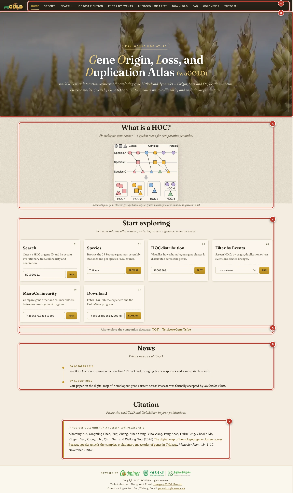
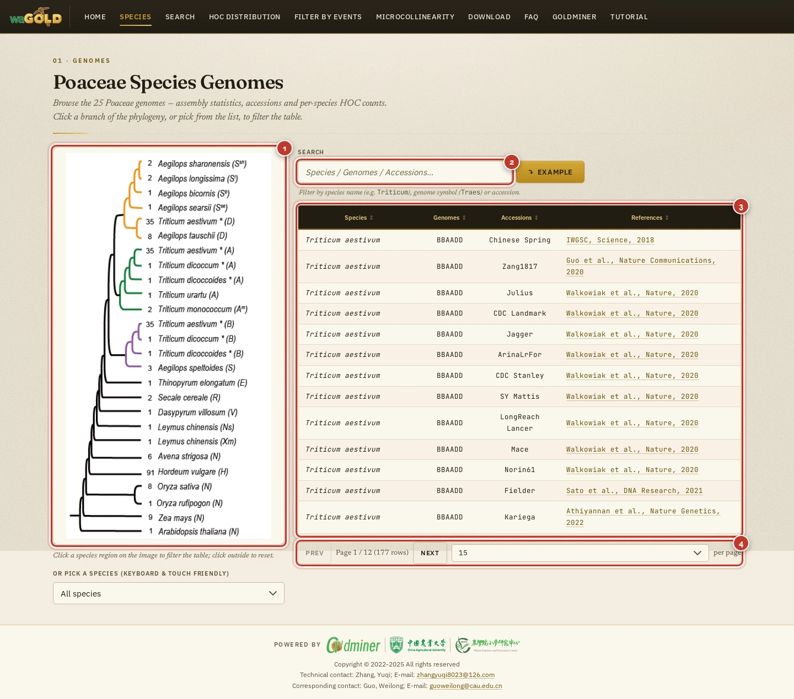
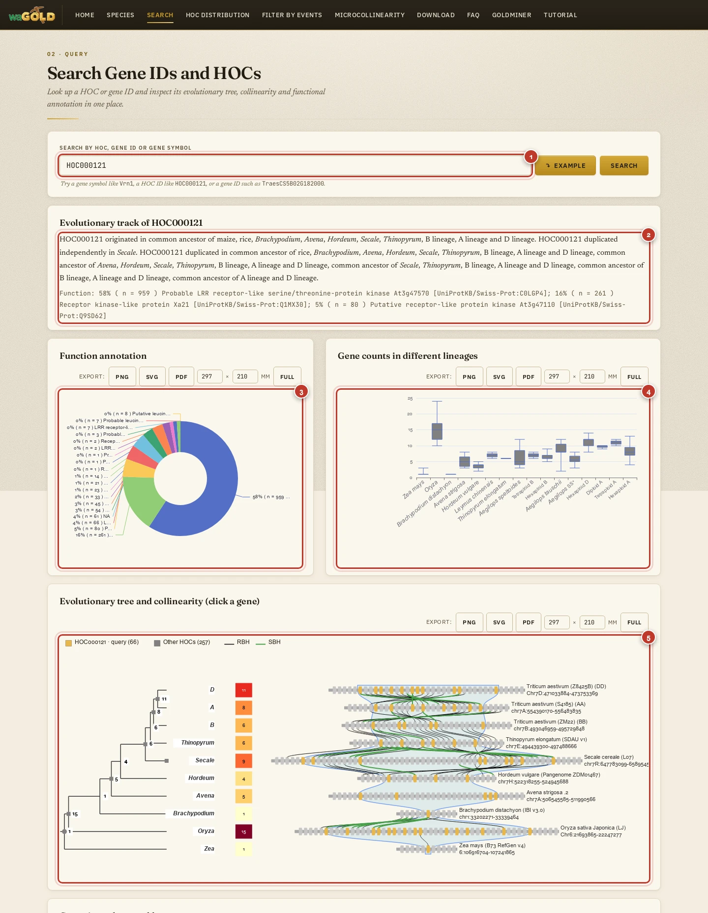
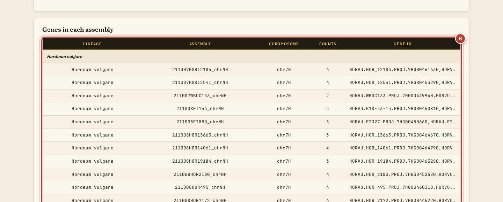
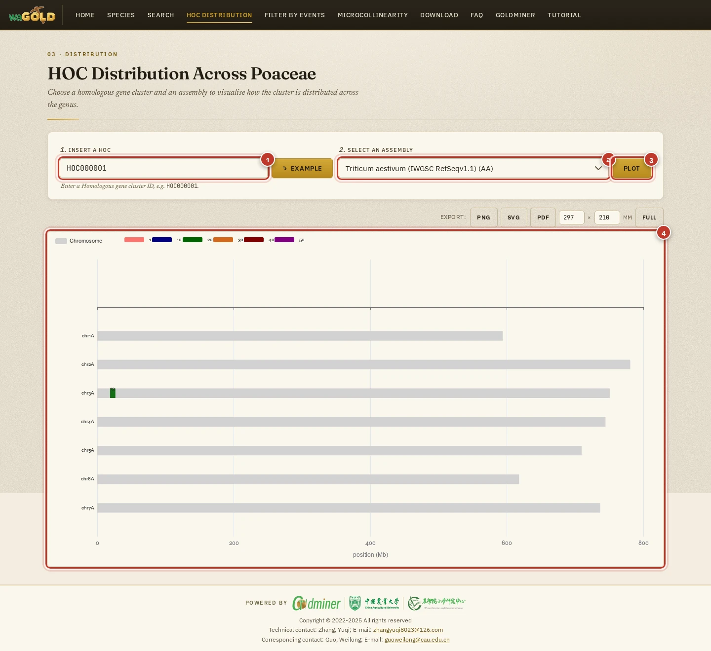
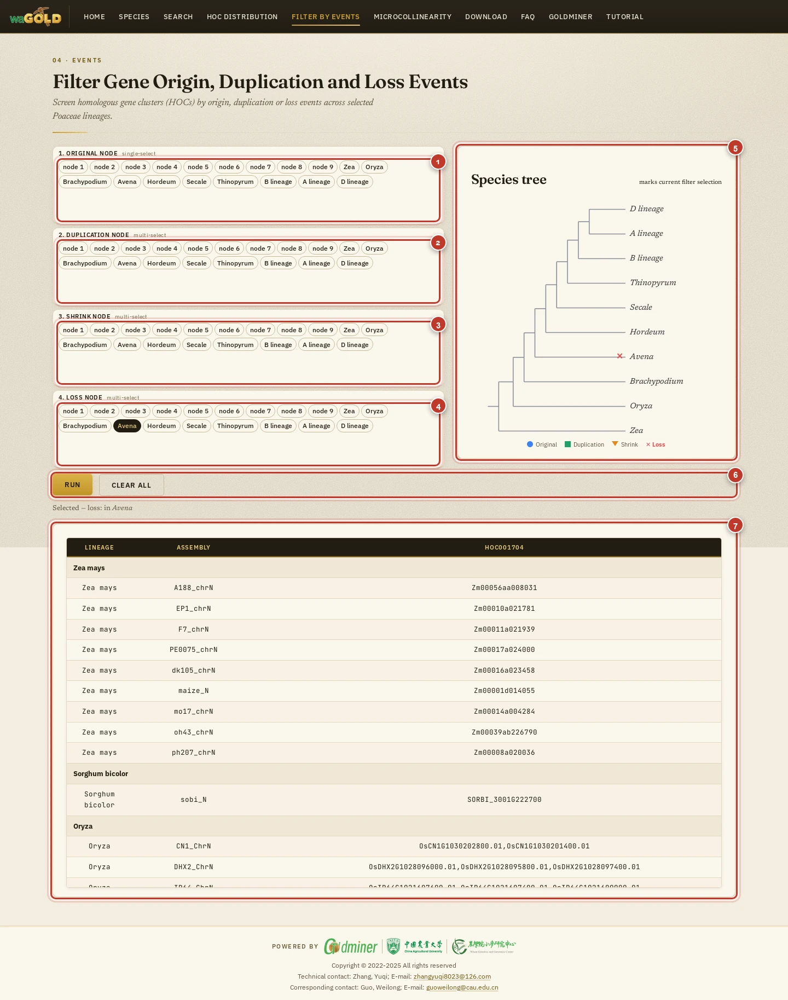
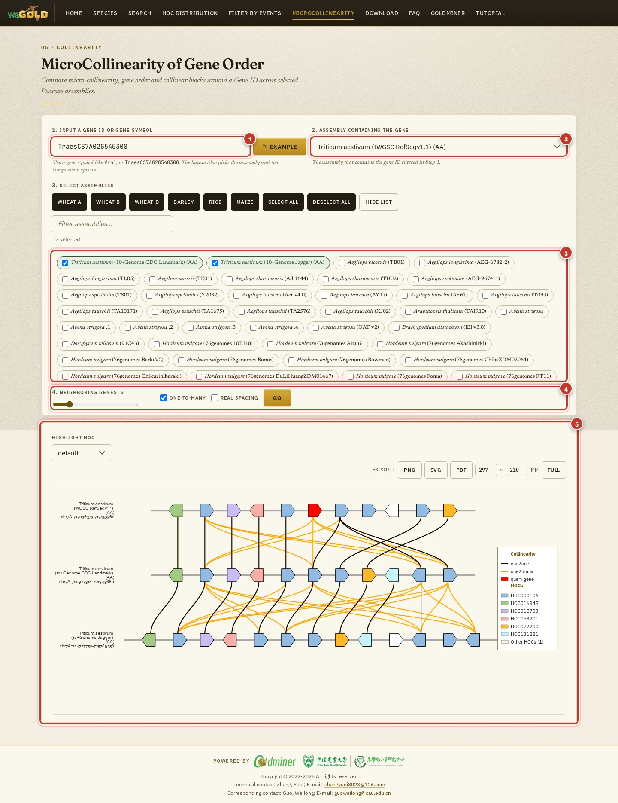
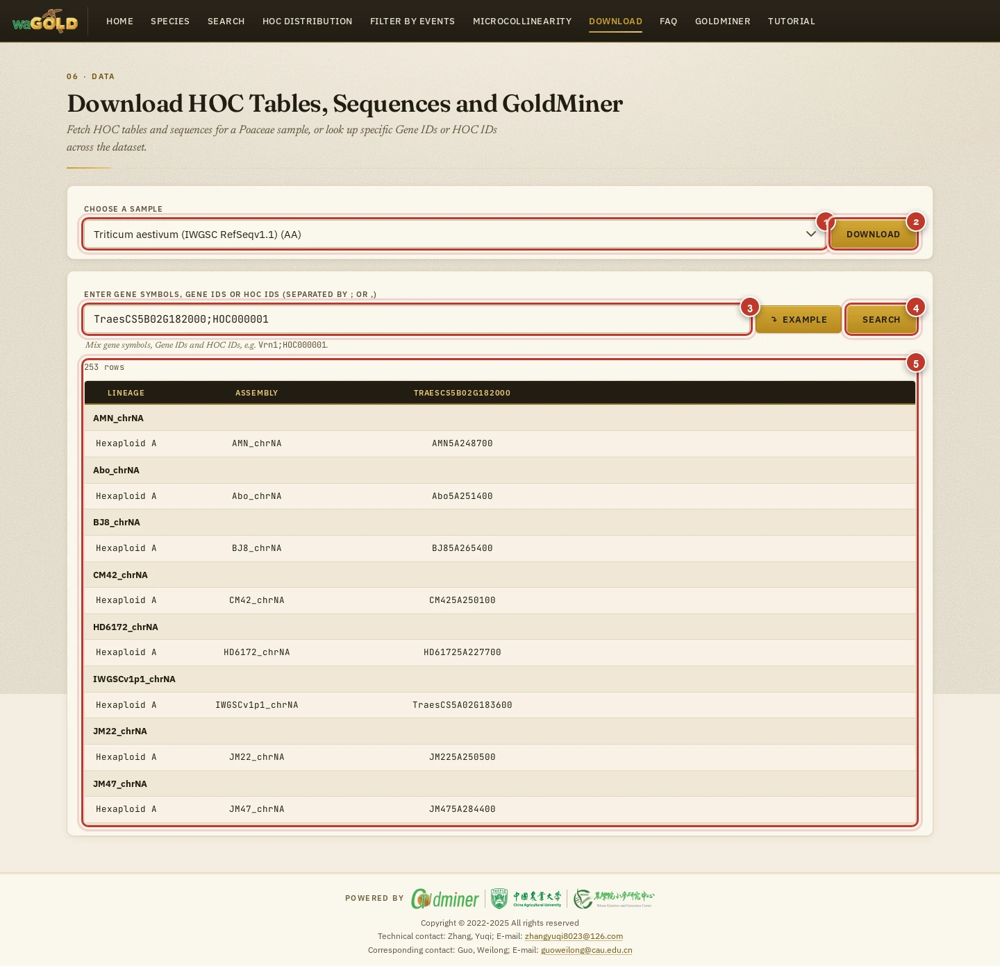
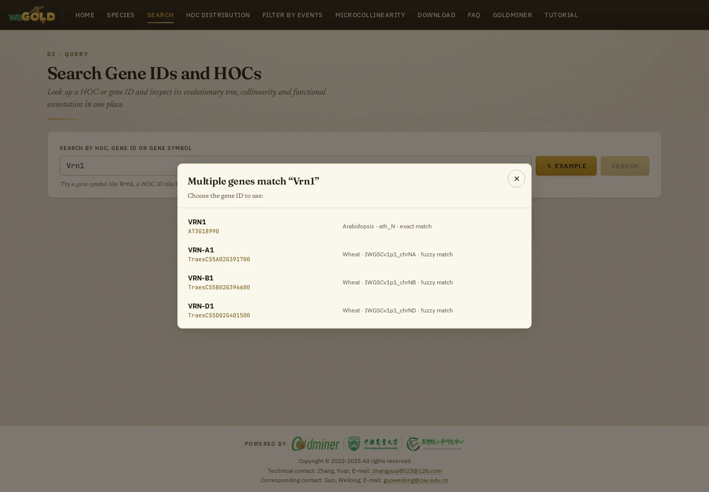

# General (概述)

## 快速开始：waGOLD 主页

**1. 顶部导航栏。** 可直接进入 Species、Search、HOC distribution、Filter by Events、MicroCollinearity、Download 和 FAQ。

**2. 主页标题区。** 顶部标签为 **Pan-genus HOC Atlas**。waGOLD 是一个交互式 webserver，用于研究禾本科物种中的基因起源、丢失和复制事件。

**3. What is a HOC?** 同源基因簇（Homologous Gene Cluster, HOC）的定义与示意图。

**4. Start exploring。** 六个功能卡片，每个卡片都预填了示例（Gene ID、HOC ID 或基因 symbol）。可直接修改后点击按钮，打开对应页面并自动运行示例。

**5. TGT 链接。** 跳转到配套的 TGT（Triticeae Gene Tribe）数据库。

**6. News。** 网站更新记录，包括 FastAPI 后端上线和论文接收信息。

**7. Citation。** 如果使用 GoldMiner 或 waGOLD，请引用这里列出的论文。

## 说明

waGOLD 提供交互式可视化、数据导出（PNG、SVG、PDF 和表格）以及外部数据库链接。表单工具使用编号步骤引导输入。大多数模块上方是输入区，下方是输出区。

每个 `Example` 按钮都会填入一组有效示例。建议先运行示例，了解输出格式后再输入自己的 Gene ID 或 HOC ID。

# Species (物种)

**1. 物种系统发育树。** 树的拓扑来自 GoldMiner，展示数据库中 25 个禾本科基因组之间的关系。点击分支或物种标签可筛选右侧表格。

**2. 搜索框。** 可按物种名、基因组缩写或登录号过滤，例如 `Triticum` 或 `Traes`。

**3. 基因组表格。** 显示物种、染色体组符号、组装统计、登录号和参考文献。

**4. 分页控件。** 可翻页或调整每页显示行数。

# Search (搜索)

**1. 按 HOC 或 Gene ID 搜索。** 输入 `HOC000121` 或 `TraesCS5B02G182000` 等 ID，然后点击 `Search`。

**2. 进化轨迹摘要。** 根据 HOC 推断起源、复制和丢失事件，并根据成员基因给出可能的功能描述。

**查询 Note。** 结果上方会显示 `Note`，记录你输入的原始内容、系统自动转换或用户手动选择的基因、解析后的 Gene ID 和组装、对应的 HOC，以及运行状态。可用于确认 `Rht2` 等 symbol 是否匹配到了预期的基因。

**3. 功能注释。** 交互式饼图，显示 HOC 内基因的功能分类和比例。

**4. 不同谱系的基因数。** 箱线图显示 HOC 基因数在各谱系中的分布。

**5. 进化树与共线性。** 该组合图包含：
- **物种树（左）：** 末端数字是每个物种中的基因数；祖先节点数字是推断的祖先基因数。圆圈、方块、三角和叉号分别表示起源、复制、收缩和丢失事件。
- **热图（中）：** 颜色越红表示基因数越多，灰色表示 0。
- **微共线性图（右）：** 当前 HOC 的基因高亮显示，其他 HOC 的基因为灰色。点击任意基因可查看 Gene ID、HOC ID、基因组位置和功能描述。

**6. 各组装中的基因。** 表格列出谱系、组装、染色体、基因数和 Gene ID。表格上方按钮可下载表格、CDS 序列和蛋白序列。

# HOC Distribution (HOC 分布)

**1. 输入 HOC。** 例如 `HOC000001`。

**2. 选择组装。** 选择要绘制分布的参考基因组组装。

**3. Plot。** 点击 `Plot` 运行分析。

**4. 输出。** 灰色条带表示所选组装的染色体；彩色区块表示 HOC 的位置和基因数。鼠标悬停可查看数量。

# Filter by Events (按事件筛选)

**1. Original Node。** 单选：选择 HOC 起源的位置。

**2. Duplication Node。** 多选：选择发生复制的谱系。

**3. Shrink Node。** 多选：选择发生收缩的谱系。

**4. Loss Node。** 多选：选择发生丢失的谱系。图中示例选择了 *Avena* 中的丢失事件。

**5. 物种树。** 标记会随选择实时更新。点击标记可取消该选择。

**6. Run。** 点击 `Run` 检索匹配的 HOC；`Clear all` 清空选择。

**7. 结果。** 匹配的 HOC 按谱系和组装分组显示，可查看或下载结果表。

# MicroCollinearity (微共线性)

waGOLD 可以可视化一个 Gene ID 周围在多个禾本科组装之间的微共线性。

**1. 输入 Gene ID。** 例如 `TraesCS7A02G540300`。

**2. 包含该基因的组装。** 选择包含查询基因的参考组装。

**3. 选择比较组装。** 勾选一个或多个比较组装。可使用 Wheat A/B/D、Barley、Rice、Maize 快捷按钮，也可在列表中过滤。

**4. 参数与 GO。** 设置邻域基因数量，选择 `one-to-many` 和 `Real spacing`，然后点击 `GO`。

**5. 输出。** 图中显示基因和同源连接线。查询基因用红色高亮；连线颜色区分一对一和一对多关系。只有查询区域附近存在共线性区块的组装才会显示。点击任意基因可查看详情和外部链接。

# Download (下载)

**1. 选择样本。** 从下拉框选择一个样本组装。

**2. Download。** 下载该样本的 HOC / gene2clu2loc 表格。

**3. Gene 或 HOC 查询。** 输入一个或多个 Gene ID 或 HOC ID，用 `;` 或 `,` 分隔，例如 `TraesCS5B02G182000;HOC000001`。

**4. Search。** 运行查询。

**5. 结果。** 结果表显示每个查询基因或 HOC 对应的谱系和组装。

# Gene symbol 搜索

Search、MicroCollinearity 和 Download 页面除 Gene ID、HOC ID 外，也支持基因 symbol。

- 输入 `Vrn1`、`Rht-A1`、`TaAPO-A1` 等基因名。
- 如果只有一个唯一匹配，waGOLD 会自动转换为对应 Gene ID 并执行查询。
- 如果有多个匹配，会列出候选基因的 Gene ID、物种和组装，选择后继续。
- 已存在的 Gene ID 和 HOC ID 会原样传递，不会误转换。
- 在 MicroCollinearity 中，如果选择的基因属于其他物种，会自动切换到对应的参考组装。
- Download 支持用 `;` 或 `,` 分隔多个 symbol，查询前会逐个解析。

# Tips (提示)

- 所有 `Example` 按钮都会填入有效示例，可直接运行。
- 图表可导出为 PNG、SVG 或 PDF。点击 `Full` 可全屏查看。
- 手机上密集图表可横向滑动。全屏后可手指拖动或用鼠标拖动平移。
- 点击 `Full` 会尝试让支持的移动浏览器横屏；iOS 不支持自动横屏，请手动旋转设备。
- 截图中的编号与上方步骤一一对应。
